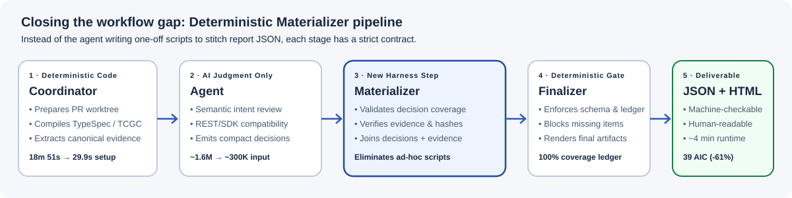
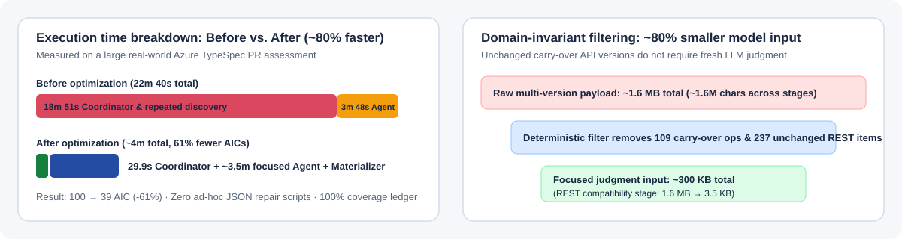

# Beyond prompting: How to work effectively with AI agents on hard, long-running tasks

_Lessons from optimizing a 40,000-line Azure TypeSpec assessment skill—cutting AI Credit (AIC) usage by 61% and execution time from ~20 minutes to ~4 minutes._

> **Companion post:** For the full benchmark data behind how we choose models across reasoning effort, task cost, and latency, read **[Blog 2: Comparing 11 Frontier Models Across Effort, Cost, Latency, and Tasks](blog-2-frontier-model-comparison.md)**.

| Metric | Before | After | Improvement |
| --- | --- | --- | --- |
| **AI Credit (AIC) usage** | 100 | 39 | **61% reduction** |
| **End-to-end execution time** | ~20 minutes | ~4 minutes | **~80% reduction (~5x faster)** |
| **Model input size** | ~1.6M | ~300K | **~80% reduction** |

---

## 1. Background: A 40,000-line API assessment workflow

The [Azure TypeSpec assessment skill](https://github.com/Azure/azure-rest-api-specs/tree/main/.github/skills/azure-typespec-assessment) reviews API pull requests for semantic intent, REST and downstream SDK compatibility, Azure Guidelines compliance, and documentation completeness, generating both machine-checkable JSON and interactive HTML reports.

The skill spans **40,000+ lines of code** and faces four domain challenges:

* **Connect the findings:** Group TypeSpec diffs—which can exceed 5,000 lines in large PRs—into semantic intents, then link them to REST/SDK breaking changes, Azure guidance, and documentation evidence.
* **Control input size:** Serialized TypeSpec Client Generator Core (TCGC) diffs have a median size of **1.65 MB (32,453 lines)**, driving up token cost and latency if sent repeatedly across model turns.
* **Present information clearly:** Display complex cross-layer API changes in a way service engineers and reviewers can act on quickly.
* **Handle edge cases under strict completeness rules:** For example, is adding an optional header a breaking change? The [coverage ledger and completeness invariant](https://github.com/Azure/azure-rest-api-specs/blob/main/.github/skills/azure-typespec-assessment/docs/design.md#71-deterministic-coverage-and-optional-inference) require every changed item to be accounted for.

---

## 2. Why "letting the agent optimize it overnight" failed

**The hard part was getting the agent to make the assessment genuinely faster while keeping the reports accurate and complete—not just getting it to change code.**

My first approach sounded reasonable: **ask the agent to summarize the performance findings, run validation to test report quality, create a performance plan, and execute it overnight**. I let it work for roughly **12 hours** of elapsed development and reassessment time. The outcome was no demonstrated end-to-end speedup and regressions in report completeness. More execution time did not make the agent converge on the right solution.

### What I delegated, and what came back

In the September 15–16 _"Reassess 12 Pull Requests"_ session:

1. I asked the agent to investigate a slow Service Networking assessment and set a **five-minute end-to-end target**.
2. I asked it to update `design.md` before implementation. It implemented dependency-cache reuse and a canonical evidence scaffold intended to reduce repeated metadata work and correction loops.
3. I then asked for **12 subagents to reassess 12 historical PRs**, compare the reports with accepted baselines, and replace baselines only when equivalence was established.

The session ended with a **"Task complete"** badge, yet its own summary reported **"0/12 runs qualified"** and **"This is not yet a complete performance fix."** It had completed the implementation and report-generation activities, not the performance goal.

_Figure 1: The overnight run's completion summary. The reports were generated, but the performance and quality goals were still unmet._

| Acceptance check | Actual outcome |
| --- | --- |
| **Complete an assessment within five minutes** | **0 of 12 runs qualified.** Service Networking took **22m 40s**. |
| **Preserve report quality** | **11 of 12 reports differed substantially.** CognitiveServices retained matching core outcomes, but evidence equivalence was unconfirmed. |
| **Preserve assessment coverage** | Network / VMSS Guidelines coverage fell from **11/11 to 10/11 intents**; several REST/SDK results became `not-assessed`. |
| **Preserve compatibility decisions** | FileStorage REST findings changed from **22 to 15**; both Cloud HSM SDK findings changed from **high to medium** severity. |

### Four reasons the agent did not solve it on its own

1. **Unchecked trade-offs under optimization pressure:** In trying to improve speed, the agent changed evidence handling, guidance selection, and judgment paths. Valid findings became `not-assessed` without proving whether those changes were corrections or regressions.
2. **Confounded concurrent experiments:** Running 12 assessments concurrently with largely cold caches caused 11 initial dependency setup failures and long resource waits. Fixing those setup failures let the batch finish, but did not isolate or prove a speedup.
3. **Finishing the tasks, not the goal:** The agent generated all 12 reports and marked the task complete even though none met the five-minute target and quality preservation was unproven. Completion needed to depend on measured acceptance criteria—not activity.
4. **Long-running execution still needed supervision:** "Run this overnight" was not enough. The agent needed saved progress, clear rules for waiting and continuing, checkpoints to distinguish useful work from repeated retries, and explicit stop rules to report a blocker rather than improvise for 12 hours.

When I intervened and asked _"why the reports quality downgrades and perf still low?"_, the agent acknowledged:

> _"I fixed component-level issues, but I should not have presented that as fixing the overall performance problem."_

We rolled back the performance changes (preserving earlier correctness fixes) and rebuilt our workflow around two general agent-collaboration principles and three harness optimizations.

---

## 3. General principles for working with AI agents on long-running tasks

### 1. Separate design and implementation across model tiers

For large engineering problems, I use **segregation of duties: design with a top-capability model, then implement with a faster and cheaper model**. I stay involved in defining the problem, trade-offs, and safety boundaries so the implementation agent never has to rediscover the architecture or decide what counts as success.

1. **Design with a top-capability model at high reasoning effort.** Work through multiple proposals, identify the bottleneck each addresses, compare trade-offs, and define implementation boundaries and measurable acceptance criteria.
2. **Record the approved designs in `design.md`.** Give each option a clear handoff contract: what to change, what must remain unchanged, shared acceptance criteria, and when to stop and request a design review.
3. **Prototype different options in parallel with faster and cheaper models.** Instead of committing to the first plausible design, assign each implementation agent a bounded option in an isolated Git worktree with separate output artifacts. If an option hits a blocker, the agent reports it rather than silently changing scope or weakening acceptance criteria.
4. **Benchmark sequentially under controlled conditions.** Prototype in parallel, but benchmark separately against the same baseline and comparable cache conditions before expanding to the 12-PR regression suite.

### 2. Match the model and reasoning effort to the task

Start with the work itself: **what needs to be done, which model fits it, and how much reasoning effort does it need?** Difficult architectural design, UI/frontend coding, backend terminal engineering, and document writing call for different model strengths. Using the [Frontier Model Capability dashboard](https://haolingdong-msft.github.io/frontier-model-capability/) (detailed in [Blog 2](blog-2-frontier-model-comparison.md)), we shortlist configurations on native task results, task cost, and response time, then validate them on representative cases from our own workflow.

---

## 4. Engineering the harness: How we achieved a 5x speedup and 61% lower AIC usage

**The core idea: use deterministic code to establish facts and control execution, and use the model only for decisions that require judgment.**

### 1. Trace execution and close the workflow gap with a deterministic Materializer

Reviewing commands, tool calls, generated scripts, and timings in our [supporting performance findings](https://gist.github.com/72637b51126c2cb5d9c00145b5be3474#file-supporting-performance-findings-2026-09-15-md) revealed a critical clue: on run after run, **the agent was generating temporary one-off scripts** to look up evidence and stitch its compact decisions into the full JSON structure expected by the report finalizer.

Recurring temporary scripts reveal a missing harness step. We closed that gap between **agent decisions and finalizer input** by introducing a deterministic **Materializer**:

_Figure 2: The four-stage assessment pipeline (`Coordinator -> Agent -> Materializer -> Finalizer -> JSON + HTML report`)._

| Workflow stage | Role in the pipeline | Impact on AIC cost, speed, and quality |
| --- | --- | --- |
| **Coordinator** | Prepares the PR worktree, compiles TypeSpec/AutoRest/TCGC artifacts, and extracts canonical evidence. | Runs mechanical setup once; pre-coordinator setup dropped from ~18m 51s to ~29.9s in PR-aware validation. |
| **Agent** | Evaluates semantic intent, compatibility candidates, and Azure Guidelines where judgment is needed. | Emits compact decision records instead of regenerating large JSON structures or writing temporary helper scripts. |
| **Materializer** | Deterministically validates decision completeness, evidence references, and artifact hashes, then joins compact decisions with canonical evidence. | Eliminates ad-hoc script generation and multi-turn repair loops; missing or invalid decisions fail fast instead of inventing answers. |
| **Finalizer** | Validates schema and coverage-ledger invariants and renders the final JSON and HTML reports. | Guarantees complete, reproducible reports across runs. |

### 2. Convert mechanical discovery into deterministic compiler and graph code

Instead of asking the agent to discover, compare, correlate, and format everything in its context window, we moved mechanical work into scripts with explicit inputs and outputs:

| Work | Deterministic implementation |
| --- | --- |
| **Identify changed declarations and relationships** | TypeSpec compiler AST and symbol resolution |
| **Detect REST compatibility candidates** | Comparison of AutoRest contract evidence |
| **Detect downstream SDK candidates** | Comparison of TypeSpec Client Generator Core (TCGC) evidence |
| **Group related source changes** | Compiler-backed semantic intent grouping |
| **Check documentation presence** | Compiler-resolved effective documentation for eligible newly added declarations |
| **Construct the report** | Canonical evidence joins, schema validation, and HTML rendering |

For SDK propagation, code builds forward and reverse reference indexes once per project and comparison role, traversing from changed types to affected methods and caching those lookups rather than repeatedly walking the entire service.

The boundary is intentional: deterministic candidates are not automatically final findings, and documentation presence is not prose-quality review. Code establishes the facts and scope; the agent retains the work that benefits from engineering judgment.

### 3. Reduce model input size by ~80% (1.6M → 300K) by removing unnecessary judgment

Sending median **1.65 MB (32,453-line)** serialized TCGC diffs and repeated relationship graphs across model turns drove both latency and AIC usage. We combined general input discipline (structuring prompts strictly around pending decisions while storing full evidence once on disk) with a crucial **domain-specific invariant**:

By inspecting the largest TCGC diffs with the agent, we found that **API-version transitions carried unchanged operations into the new version**, fanning out into hundreds of candidate relationships and review requests.

We defined the safe boundary: carry-over is informational-only **when and only when** the operation is linked solely through the version transition and its route, signature, contracts, SDK surface, and documentation evidence are unchanged. Missing or altered evidence keeps the operation in the full assessment path.

In one validation case where a `Versions` declaration change was associated with **109 operations**, deterministic classification preserved the version-wide semantic summary and full operation list in the report while removing **237 exclusively associated REST candidates** and their downstream Guidelines and inference prompts—cutting model input for that case from **~1.6 MB to 3.5 KB**.

_Figure 3: Execution time reduction (22m 40s to ~4m) and domain-invariant model input reduction (~1.6 MB to ~300 KB overall, and 3.5 KB on unchanged version-transition REST candidates)._

---

## Summary: Five takeaways for long-running agent workflows

1. **Agree on design and acceptance criteria in `design.md` before delegating implementation.**
2. **Segregate duties across models:** use a high-effort frontier model for architecture and trade-offs, then run parallel bounded prototypes on faster, cheaper models in isolated worktrees.
3. **Gate completion on measured latency and quality equivalence, not task activity.**
4. **Trace what the agent repeatedly improvises and turn recurring temporary scripts into tested harness steps (like our Materializer).**
5. **Shrink model input by removing unnecessary judgment work, not required evidence.**

* **Continue reading:** **[Blog 2 — Reading the Model Frontier: Comparing 11 AI Models Across Effort, Cost, Latency, and 17 Native Benchmarks](blog-2-frontier-model-comparison.md)**
* **Architecture & design reference:** [Azure TypeSpec Assessment Design (`docs/design.md`)](https://github.com/Azure/azure-rest-api-specs/blob/main/.github/skills/azure-typespec-assessment/docs/design.md)
* **Original gist & timing breakdowns:** [Beyond prompting: solving hard, long-running problems with AI agents](https://gist.github.com/72637b51126c2cb5d9c00145b5be3474)
