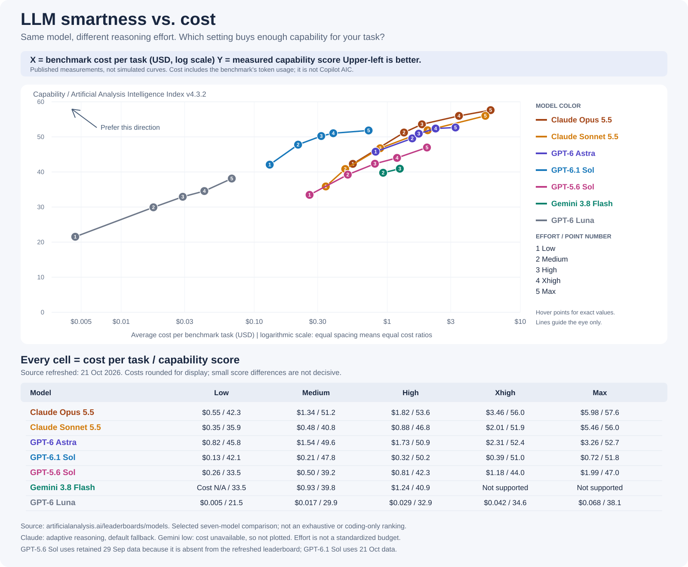
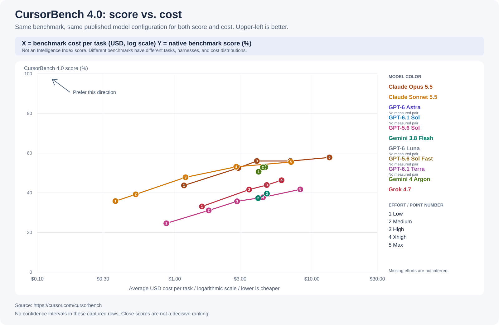
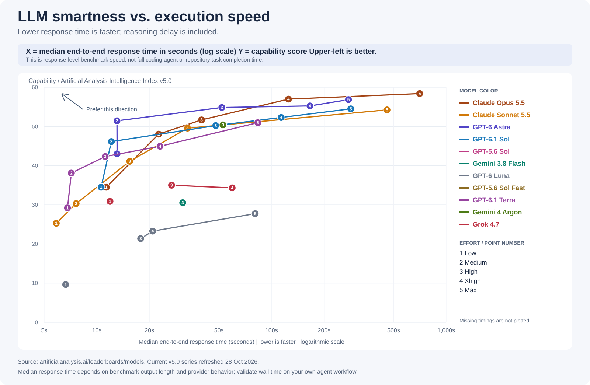
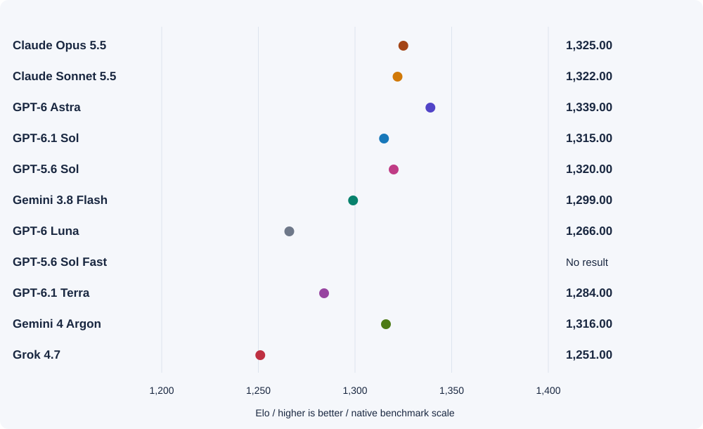
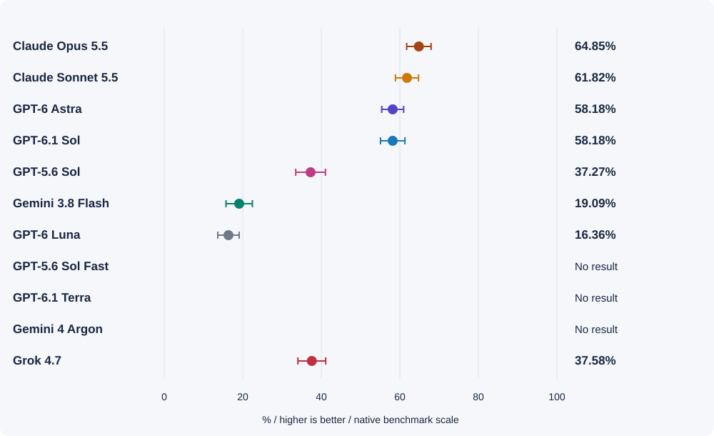
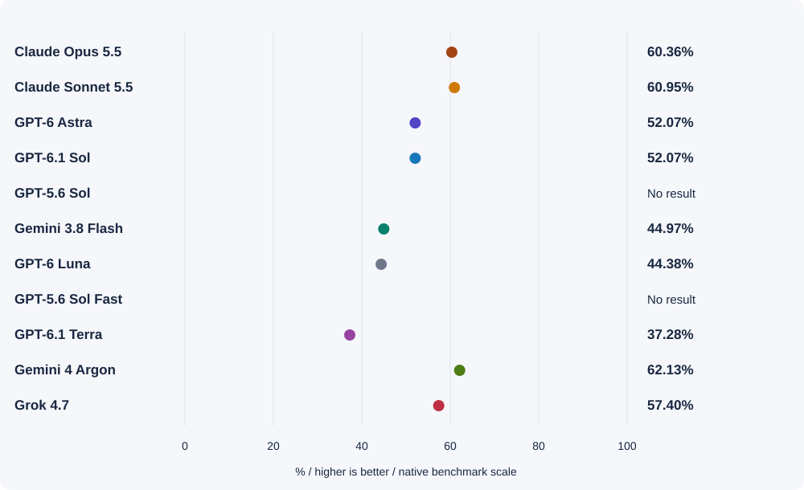
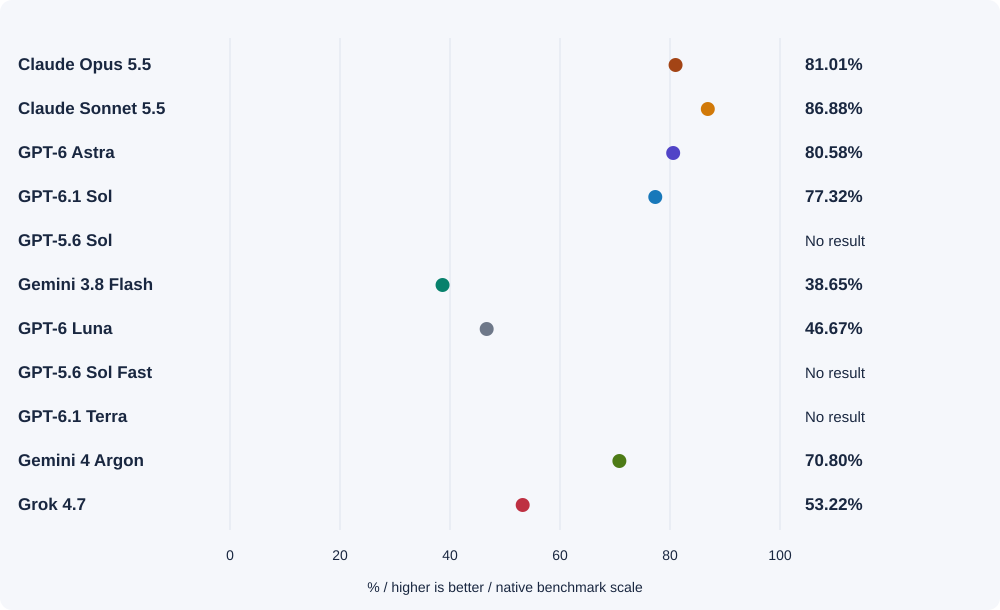

# Evaluating frontier models across smartness, cost, speed, and task specialization

_Why choosing the right model is important when working on complex, long-running engineering tasks—and how to evaluate 11 frontier model families across reasoning effort, task cost, execution latency, and 17 native task benchmarks._

---

## Why choosing the right model for complex tasks is important

GitHub Copilot's agentic harness supports more than 20 frontier models across the GPT, Claude, Gemini, and Grok families. While a strong harness manages tools, context compaction, and subagent orchestration, **the model and reasoning effort you choose still determine whether a complex, long-running engineering task converges cleanly or burns hours and budget.**

In practice, knowing which model will perform best on a complex task is surprisingly difficult for three reasons:

1. **A model family is not a single operating point.** Stepping the same model across Low (1), Medium (2), High (3), Xhigh (4), and Max (5) reasoning effort shifts its capability, total token consumption, and response latency by up to an order of magnitude.
2. **Single-number leaderboards hide critical trade-offs.** Public rankings frequently mix benchmark versions, quote per-token API rates instead of total cost per completed task, report output tokens per second instead of full thinking-plus-answer latency, or collapse UI design, terminal debugging, and document writing into a single composite score.
3. **Complex, long-running workflows amplify small model mismatches.** In multi-step agentic tasks that chain planning, repository search, code edits, and verification across dozens of turns, choosing an under-powered model wastes retries and context budget, while running a peak-capability model at Max effort on every routine step inflates latency and cost. Effective model selection requires understanding models across three distinct axes: **smartness vs. cost**, **smartness vs. execution speed**, and **task-specific strengths**.

To make those trade-offs concrete and reproducible, we built the **[Frontier Model Capability benchmark suite](https://haolingdong-msft.github.io/frontier-model-capability/)**, tracking **11 frontier model families** (Claude Opus 5.5, Claude Sonnet 5.5, GPT-6 Astra, GPT-6.1 Sol, GPT-5.6 Sol, Gemini 3.8 Flash, GPT-6 Luna, GPT-5.6 Sol Fast, GPT-6.1 Terra, Gemini 4 Argon, and Grok 4.7) across **5 reasoning effort levels** and **17 native-scale benchmarks (274 captured configuration records)**:

| Evaluation dimension | Primary benchmarks tracked | What it measures |
| --- | --- | --- |
| **Smartness vs. cost per task** | Artificial Analysis Intelligence Index v5.0, CursorBench 4.0, ARC-AGI-1 & ARC-AGI-2 (Semi-Private) | Measured capability score against average USD evaluation cost per task (log scale) across reasoning efforts 1 Low to 5 Max |
| **Smartness vs. performance (speed)** | Artificial Analysis Intelligence Index v5.0 end-to-end latency series | Measured capability score against median end-to-end response time in seconds (including thinking/reasoning delay) |
| **UI / frontend specialization** | DesignArena Website (Bradley-Terry Elo) | Blind human pairwise preference across generated websites |
| **Engineering & code migration** | Terminal-Bench 4.0, Vals Code Migration v1.1, LiveBench 2.0 (Coding, Long Agentic, Browser Use) | Executable repository task resolution (%), hidden behavior-test pass rate (%), and multi-step agentic completion |
| **Documents, analysis & reasoning** | AA-Briefcase v1.1 (Word, Analytical Quality, Presentation), GDPval-AA v2.1, LiveBench 2.0 (Research, Design, Data Analysis, Reasoning) | Rubric-check pass rates (%) and pairwise Elo across professional reports, .docx artifacts, and structured analysis |

_Table 1: Overview of the Frontier Model Capability evaluation dimensions and primary benchmark sources (refreshed October 28, 2026)._

---

## Capability vs. cost across reasoning efforts

In this chart, the **vertical axis represents model smartness (capability score)** and the **horizontal axis represents average USD cost per task (log scale)** across reasoning efforts **1 (Low) to 5 (Max)**—so **upper-left means smarter and cheaper**. For example, compare **Medium effort (point 2)** on **GPT-6.1 Sol** (blue) and **Claude Opus 5.5** (brown): both achieve nearly the same smartness (**46.1 vs. 48.1**, almost the same vertical height), but **Claude Opus 5.5** sits far to the right at **$2.45/task** versus **$0.36/task** for **GPT-6.1 Sol**—nearly **7× more expensive** for comparable capability.

_Figure 1: Capability (Artificial Analysis Intelligence Index v5.0) vs. average benchmark cost per task (USD, logarithmic scale) across Low (1) through Max (5) reasoning effort. Upper-left is better: higher measured smartness for lower task cost. Benchmark USD cost reflects evaluation token usage, not GitHub Copilot AI Credits._

Because measured evaluation costs span more than **1,000x**—from **$0.005/task** on GPT-6 Luna Low to **$10.04/task** on Claude Opus 5.5 Max—plotting cost on a logarithmic scale exposes four structural findings:

1. **GPT-6.1 Sol and GPT-6.1 Terra define the upper-left cost-efficiency frontier.** On Intelligence Index v5.0, GPT-6.1 Sol climbs from **34.5 ($0.16/task)** at Low to **46.1 ($0.36)** at Medium, **50.2 ($0.59)** at High, **52.3 ($0.76)** at Xhigh, and **54.5 ($1.27)** at Max. At High effort ($0.59/task), GPT-6.1 Sol scores higher than Claude Opus 5.5 Medium (48.1 at $2.45/task) at roughly one-quarter of the benchmark task cost.
2. **Peak smartness on flagship models has a steep cost inflection above High effort.** Claude Opus 5.5 reaches the highest overall score (**58.4 at Max**) and GPT-6 Astra reaches **56.9 at Max**. However, stepping Claude Opus 5.5 from High (51.7 at $3.46) to Max (58.4 at $10.04) nearly triples task cost for +6.7 points. On GPT-6 Astra, High (**54.8 at $3.24**) captures most of the capability gain before Max (**56.9 at $6.24**) nearly doubles the cost.
3. **A mid-tier model at Max effort can cost as much as a flagship model at Max effort.** Because of the volume of reasoning tokens generated, Claude Sonnet 5.5 Max costs **$10.02 per task (score 54.2)**—virtually identical in benchmark dollar cost to Claude Opus 5.5 Max (**$10.04 per task, score 58.4**).
4. **Cross-checking on CursorBench 4.0 and ARC-AGI-1/2 shows that higher effort is not always monotonically better.** On CursorBench 4.0, Claude Opus 5.5 ties at **56.00%** across High ($3.97, 68 steps) and Xhigh ($6.98, 109 steps) before reaching **57.80%** at Max ($13.43, 185 steps). On ARC-AGI-1, GPT-6.1 Sol High (**98.50% at $0.059/task**) outperforms Max (**96.50% at $0.095/task**), and on Intelligence Index v5.0, Grok 4.7 High (**35.0 at $6.18**) edges out Xhigh (**34.3 at $7.51**).

| Model family | 1 · Low (Cost / Score) | 2 · Medium (Cost / Score) | 3 · High (Cost / Score) | 4 · Xhigh (Cost / Score) | 5 · Max (Cost / Score) |
| --- | --- | --- | --- | --- | --- |
| **Claude Opus 5.5** | $0.98 / 34.5 | $2.45 / 48.1 | $3.46 / 51.7 | $6.05 / 57.0 | $10.04 / 58.4 |
| **GPT-6 Astra** | $1.42 / 43.0 | $2.73 / 51.5 | $3.24 / 54.8 | $3.66 / 55.3 | $6.24 / 56.9 |
| **GPT-6.1 Sol** | $0.16 / 34.5 | $0.36 / 46.1 | $0.59 / 50.2 | $0.76 / 52.3 | $1.27 / 54.5 |
| **Claude Sonnet 5.5** | $0.51 / 25.3 | $0.78 / 30.3 | $1.64 / 41.1 | $4.09 / 49.6 | $10.02 / 54.2 |
| **GPT-6.1 Terra** | $0.071 / 29.2 | $0.17 / 38.1 | $0.26 / 42.3 | $0.40 / 45.0 | $0.96 / 51.0 |
| **Gemini 4 Argon** | _See CursorBench / ARC_ | _See CursorBench / ARC_ | $3.84 / 50.4 | _No measurement_ | _No measurement_ |
| **Grok 4.7** | $2.92 / 30.9 | _See CursorBench / ARC_ | $6.18 / 35.0 | $7.51 / 34.3 | _No measurement_ |
| **Gemini 3.8 Flash** | Cost N/A / 22.3 | $6.26 / 30.0 | $7.77 / 30.5 | _No measurement_ | _No measurement_ |
| **GPT-6 Luna** | $0.005 / 9.7 | $0.042 / 18.3 | $0.073 / 21.4 | $0.10 / 23.3 | $0.15 / 27.8 |
| **GPT-5.6 Sol** | _v4.3.2 archive ($0.26 / 33.5)_ | _v4.3.2 archive ($0.50 / 39.2)_ | _v4.3.2 archive ($0.81 / 42.3)_ | _v4.3.2 archive ($1.18 / 44.0)_ | _v4.3.2 archive ($1.99 / 47.0)_ |
| **GPT-5.6 Sol Fast** | _No measurement_ | _No measurement_ | _No measurement_ | _No measurement_ | _No measurement_ |

_Table 2: Intelligence Index v5.0 cost per task and capability score across all five reasoning efforts. Because Gemini 4 Argon only has High in v5.0 and GPT-5.6 Sol is archived under v4.3.2, we cross-check multi-effort cost curves on native CursorBench 4.0 and ARC-AGI-1/2 charts below._

_Figure 2: Native CursorBench 4.0 score (%) vs. average USD cost per task across reasoning efforts, showing Low/Medium/High curves for Gemini 4 Argon and all five effort settings for GPT-5.6 Sol._

---

## Capability vs. end-to-end response time

When working interactively with an agent—or chaining multiple subagent turns inside a long-running workflow—**output tokens per second can be misleading**. Reasoning models spend significant time thinking before emitting their first visible token. To capture true model latency, we plot **median end-to-end response time in seconds (including reasoning delay)** against capability score.

_Figure 3: Capability (Intelligence Index v5.0) vs. median end-to-end response time in seconds (logarithmic scale). Upper-left is better: higher smartness with lower end-to-end response latency._

Three practical lessons stand out from the response-time trajectories:

1. **The 7–15 second interactive sweet spot:** GPT-6.1 Terra Medium (**7.1s**, score 38.1) and High (**11.2s**, score 42.3), Claude Sonnet 5.5 Medium (**7.6s**, score 30.3) and High (**15.4s**, score 41.1), GPT-6.1 Sol Medium (**12.1s**, score 46.1), and GPT-6 Astra Medium (**13.0s**, score 51.5) all finish in roughly 7 to 15 seconds—fast enough for tight human-in-the-loop iteration and parallel subagent execution.
2. **The Max-effort latency cliff:** Stepping up to Max pushes median single-response time to **83.5s on GPT-6.1 Terra**, **275.8s (~4.6 minutes) on GPT-6 Astra**, **284.2s (~4.7 minutes) on GPT-6.1 Sol**, **458.6s (~7.6 minutes) on Claude Sonnet 5.5**, and **705.2s (~11.8 minutes) on Claude Opus 5.5**. If an agent workflow invokes a Max-effort model across 10 serial turns, model thinking time alone will exceed 45 to 100 minutes.
3. **Model response time is only one component of total agent wall time:** Even a 12-second model response turns into a 20-minute workflow if the agent makes dozens of serial tool calls, re-reads megabytes of raw repository files, or retries failed scripts—which is why fast model selection must be paired with deterministic context reduction in the harness.

| Model family | 1 · Low (Time / Score) | 2 · Medium (Time / Score) | 3 · High (Time / Score) | 4 · Xhigh (Time / Score) | 5 · Max (Time / Score) |
| --- | --- | --- | --- | --- | --- |
| **Claude Opus 5.5** | 11.3s / 34.5 | 22.6s / 48.1 | 39.8s / 51.7 | 125.0s / 57.0 | 705.2s / 58.4 |
| **GPT-6 Astra** | 13.1s / 43.0 | 13.0s / 51.5 | 51.9s / 54.8 | 165.9s / 55.3 | 275.8s / 56.9 |
| **GPT-6.1 Sol** | 10.6s / 34.5 | 12.1s / 46.1 | 47.9s / 50.2 | 113.6s / 52.3 | 284.2s / 54.5 |
| **Claude Sonnet 5.5** | 5.9s / 25.3 | 7.6s / 30.3 | 15.4s / 41.1 | 33.1s / 49.6 | 458.6s / 54.2 |
| **GPT-6.1 Terra** | 6.8s / 29.2 | 7.1s / 38.1 | 11.2s / 42.3 | 23.0s / 45.0 | 83.5s / 51.0 |
| **Gemini 4 Argon** | _No timing_ | _No timing_ | 52.7s / 50.4 | _No timing_ | _No timing_ |
| **Grok 4.7** | 11.9s / 30.9 | _No timing_ | 26.8s / 35.0 | 59.5s / 34.3 | _No timing_ |
| **Gemini 3.8 Flash** | _No timing_ | _No timing_ | 31.0s / 30.5 | _No timing_ | _No timing_ |
| **GPT-6 Luna** | 6.6s / 9.7 | _No timing_ | 17.8s / 21.4 | 20.9s / 23.3 | 80.6s / 27.8 |

_Table 3: Median end-to-end response time (seconds, including reasoning delay) and Intelligence Index v5.0 score across reasoning efforts._

---

## Task specialization across 17 benchmarks

Aggregate smartness, cost, and speed still do not tell you whether a model excels at **visual frontend design**, **executable terminal/repository engineering**, or **structured document writing**. Rather than inventing a synthetic radar chart, we evaluate all 11 model families across **17 native-scale task benchmarks (274 captured configuration rows)**:

| Model family | UI / Frontend (DesignArena Website, Elo) | Terminal Engineering (Terminal-Bench 4.0, resolved %) | Code Migration (Vals v1.1, pass % / USD / time) | Long Agentic (LiveBench 2.0, score / USD) | Document Rubric (AA-Briefcase Word, %) | Analytical Quality (AA-Briefcase, Elo) |
| --- | --- | --- | --- | --- | --- | --- |
| **Claude Opus 5.5** | 1,325.00 _(Unstated)_ | **64.85%** _(Max / Claude Code)_ | 81.01% _($72.40 / 209m)_ | 72.80 _($38.01)_ | 60.36% _(Max)_ | **2,135.15** _(Max)_ |
| **Claude Sonnet 5.5** | 1,322.00 _(Unstated)_ | 61.82% _(Max / Claude Code)_ | **86.88%** _($43.88 / 247m)_ | 63.40 _($35.01)_ | 60.95% _(Max)_ | 2,104.30 _(Max)_ |
| **GPT-6 Astra** | **1,339.00** _(Max)_ | 58.18% _(Max / Codex)_ | 80.58% _($62.07 / 87m)_ | **77.50** _($38.38)_ | 52.07% _(Max)_ | 1,752.19 _(Max)_ |
| **GPT-6.1 Sol** | 1,315.00 _(Unstated)_ | 58.18% _(Max / Codex)_ | 77.32% _(**$9.51** / 99m)_ | 68.70 _(**$6.49**)_ | 52.07% _(Max)_ | 1,766.62 _(Max)_ |
| **Gemini 4 Argon** | 1,316.00 _(Unstated)_ | N/A | 70.80% _($44.79 / 142m)_ | 61.20 _($13.84)_ | **62.13%** _(High)_ | 1,550.88 _(High)_ |
| **GPT-5.6 Sol** | 1,320.00 _(Xhigh)_ | 37.27% _(Max / Codex)_ | N/A | N/A | N/A | N/A |
| **Grok 4.7** | 1,251.00 _(Unstated)_ | 37.58% _(Xhigh / Grok Build)_ | 53.22% _($38.05 / 66m)_ | 46.10 _($18.77)_ | 57.40% _(Xhigh)_ | 1,933.69 _(Xhigh)_ |
| **Gemini 3.8 Flash** | 1,299.00 _(Unstated)_ | 19.09% _(High / mini-SWE)_ | 38.65% _($15.79 / 155m)_ | 16.50 _($7.04)_ | 44.97% _(High)_ | 1,136.55 _(High)_ |
| **GPT-6.1 Terra** | 1,284.00 _(Unstated)_ | N/A | N/A | 48.60 _($6.47)_ | 37.28% _(Max)_ | 1,491.89 _(Max)_ |
| **GPT-6 Luna** | 1,266.00 _(Unstated)_ | 16.36% _(Max / Codex)_ | 46.67% _($0.83 / 60m)_ | 30.90 _($0.97)_ | 44.38% _(Max)_ | 1,376.09 _(Max)_ |
| **GPT-5.6 Sol Fast** | N/A | N/A | N/A | N/A | N/A | N/A |

_Table 4: Task-specific comparison across six representative native-scale benchmarks from the 17-benchmark suite._

### Four task-fit takeaways for engineering workflows

1. **UI and frontend generation (DesignArena Website, LiveBench Design):** GPT-6 Astra Max leads human visual preference on DesignArena Website (**1,339.00 Elo** across 7,828 battles), followed closely by Claude Opus 5.5 (**1,325.00**), Claude Sonnet 5.5 (**1,322.00**), and GPT-5.6 Sol Xhigh (**1,320.00**). For visual and structural inspection of generated documents/presentations (LiveBench Design), Claude Opus 5.5 Max (**86.90**) and Claude Sonnet 5.5 Max (**85.00**) lead.
2. **Terminal engineering, code migration, and long-horizon agentic work:**
   - **Terminal-Bench 4.0:** Claude Opus 5.5 Max (**64.85%**) and Claude Sonnet 5.5 Max (**61.82%**) lead in Claude Code, while GPT-6 Astra Max and GPT-6.1 Sol Max tie at **58.18%** in Codex. Notably, across 330 trials per setting on GPT-6 Astra, High (**57.88%**), Xhigh (**57.88%**), and Max (**58.18%**) have overlapping confidence intervals—meaning High captures virtually the same terminal resolution rate at a fraction of Max cost and latency.
   - **Vals Code Migration v1.1 & LiveBench Long Agentic:** Claude Sonnet 5.5 Max leads code migration (**86.88%**, $43.88/task) and GPT-6 Astra Max leads long-agentic execution (**77.50**, $38.38/task). However, **GPT-6.1 Sol Max is the standout value leader**, achieving **77.32% on Code Migration for just $9.51/task** (vs. $62.07–$72.40 on Astra/Opus) and **68.70 on Long Agentic for $6.49/task**, while tying Claude Opus 5.5 at the top of LiveBench Coding (**96.00 at $0.48/task** vs. **96.30 at $5.03/task**).
3. **Documents, analytical reports, and structured reasoning (AA-Briefcase, GDPval-AA, LiveBench):** Gemini 4 Argon High leads Word .docx rubric checks (**62.13%**), LiveBench Reasoning (**95.10**), and LiveBench Data Analysis (**85.20**), whereas Claude Opus 5.5 Max and Claude Sonnet 5.5 Max lead pairwise human preference for analytical quality (**2,135.15** and **2,104.30 Elo**), presentation (**1,715.10** and **1,711.94 Elo**), and broader professional deliverables (GDPval-AA **1,866.27** and **1,842.06 Elo**).
4. **How to combine models in complex workflows (segregation of duties):** Don't use one model setting for every step of a long-running task. Use a top-smartness frontier model (Claude Opus 5.5 or GPT-6 Astra at High/Max) to diagnose architecture, adjudicate subtle API compatibility rules, and define acceptance criteria—then delegate bounded implementation prototypes in parallel Git worktrees to fast, cost-efficient models (GPT-6.1 Sol or GPT-6.1 Terra at Medium/High).

_Figure 4: UI / Frontend capability — DesignArena Website pairwise preference Elo._

_Figure 5: Engineering / Backend proxy — Terminal-Bench 4.0 resolved rate (%) with 95% confidence intervals._

_Figure 6: Document writing — AA-Briefcase v1.1 Word (.docx) rubric-check pass rate (%)._

_Figure 7: Code migration — Vals Code Migration v1.1 hidden behavior-test pass rate (%) with USD cost and duration._

---

### Choosing the right model and effort for your task

| Workflow stage or task type | Recommended primary picks | Recommended high-efficiency picks | Why |
| --- | --- | --- | --- |
| **Upfront architecture, root-cause analysis & subtle compatibility rules** | Claude Opus 5.5 (High/Max), GPT-6 Astra (High/Max) | GPT-6.1 Sol (High/Xhigh) | Highest ceiling on Intelligence Index v5.0 (58.4 / 56.9), Terminal-Bench (64.85%), and Long Agentic (77.50) |
| **Bounded coding, parallel worktree prototyping & CI subagents** | GPT-6.1 Sol (Medium/High), Claude Sonnet 5.5 (High) | GPT-6.1 Terra (Medium/High) | GPT-6.1 Sol ties Astra on Terminal-Bench (58.18%), scores 96.00 on LiveBench Coding at $0.48/task, and responds in 12.1s at Medium |
| **Large-scale code migration & multi-file refactoring** | Claude Sonnet 5.5 (Max), Claude Opus 5.5 (Max), GPT-6 Astra (Max) | GPT-6.1 Sol (Max) | Sonnet 5.5 leads pass rate (86.88%); GPT-6.1 Sol reaches 77.32% at $9.51/migration (6x–7x lower cost than Opus/Astra) |
| **UI / frontend generation & visual polish** | GPT-6 Astra (Max), Claude Opus 5.5, Claude Sonnet 5.5 | GPT-5.6 Sol (Xhigh), Gemini 4 Argon, GPT-6.1 Sol | Top human preference Elo on DesignArena Website (1,339 / 1,325 / 1,322) and LiveBench Design (86.90 / 85.00) |
| **Technical documents, .docx artifacts & analytical reports** | Claude Opus 5.5 (Max), Claude Sonnet 5.5 (Max), Gemini 4 Argon (High) | Grok 4.7 (Xhigh), GPT-6.1 Sol (Max) | Argon High leads Word rubric checks (62.13%) and Data Analysis (85.20); Opus/Sonnet lead analytical quality (2,135 / 2,104 Elo) |

* **Explore the full interactive dashboard:** [haolingdong-msft.github.io/frontier-model-capability](https://haolingdong-msft.github.io/frontier-model-capability/)

---

## Data sources

All charts and tables in this post are generated from primary public benchmark snapshots captured on **October 28, 2026** (and verified against upstream leaderboards on October 30, 2026). Each benchmark is plotted on its native scale without mixing incompatible composite versions or inferring missing effort tiers:

| Benchmark | Dimension | Methodology & evaluation scope | Official source |
| --- | --- | --- | --- |
| **Artificial Analysis Intelligence Index v5.0** | Capability vs. cost & response time | Independent API evaluation across 10 benchmarks (GPQA Diamond, Humanity's Last Exam, Terminal-Bench Hard, $\tau^2$-Bench, LiveCodeBench, AIME 2025, MMMU-Pro, CritPt, IFBench, Long-Context Reasoning), paired with measured USD task cost and median end-to-end latency. | [artificialanalysis.ai](https://artificialanalysis.ai/leaderboards/models) |
| **CursorBench 4.0** | Capability vs. cost (coding) | Real-world multi-file repository software engineering sessions measuring resolution rate (%), agent steps, and API cost per task across reasoning efforts. | [cursor.com/cursorbench](https://cursor.com/cursorbench) |
| **ARC-AGI-1 & ARC-AGI-2 (Semi-Private)** | Capability vs. cost (abstract reasoning) | Held-out semi-private evaluation sets operated by the ARC Prize Foundation to prevent training contamination, measuring accuracy (%) vs. USD cost per task. | [arcprize.org/leaderboard](https://arcprize.org/leaderboard) |
| **DesignArena: Website** | UI / frontend specialization | Blind human pairwise preference (Bradley-Terry Elo across 1.15M+ votes) on rendered websites generated from identical prompts. | [designarena.ai](https://www.designarena.ai/leaderboard/website) |
| **Terminal-Bench 4.0** | Engineering & systems specialization | Dockerized, executable command-line and systems engineering tasks graded by deterministic verification scripts ($\pm$95% CI). | [tbench.ai](https://www.tbench.ai/) |
| **AA-Briefcase v1.1 & GDPval-AA v2.1** | Documents & professional reports | Rubric-check pass rates (%) on Word (`.docx`) deliverables and blind pairwise Elo on analytical quality, presentations, and knowledge-work reports. | [AA-Briefcase](https://artificialanalysis.ai/evaluations/aa-briefcase) · [GDPval-AA](https://artificialanalysis.ai/evaluations/gdpval-aa) |

* **Raw machine-readable snapshots:** [`aa-benchmark-snapshot.json`](aa-benchmark-snapshot.json) and [`task-benchmark-snapshot.json`](task-benchmark-snapshot.json)

